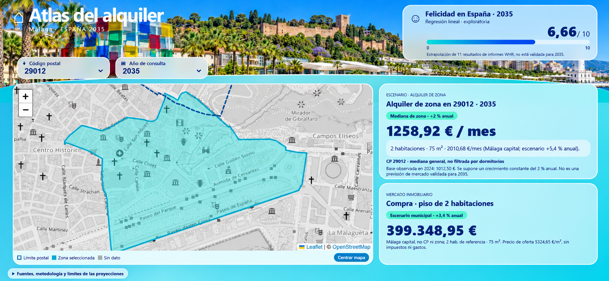

## Simulador interactivo SPAIN 2035

[▶ Abrir el simulador de Málaga](https://spain-2035-malaga.streamlit.app/)

Consulta el alquiler por zona, la referencia de compra de vivienda
y la felicidad de España para el año seleccionado.

# SPAIN 2035 · ¿Podré quedarme en Málaga?

**Proyecto 7 de Regresión — Factoría F5 · Nivel 2 (nivel medio)**  
**Aplicación:** *Mediterráneo de Cristal*

## 1. Objetivo del proyecto

SPAIN 2035 investiga una pregunta concreta: **¿cómo pueden evolucionar los alquileres de Málaga y qué implicaciones tienen para la posibilidad de vivir, ahorrar y construir un futuro en la ciudad?**

El proyecto combina análisis exploratorio de datos (EDA), modelos supervisados de regresión, validación temporal y una aplicación web interactiva. Como contexto, también muestra la evolución económica y de la felicidad en España.


## Simulador interactivo — Mediterráneo de Cristal



El simulador permite explorar los alquileres por zonas
de Málaga, consultar referencias de compra de viviendas
de dos habitaciones y visualizar escenarios hasta 2035.

Para utilizar la aplicación interactiva, ejecutar
localmente: `python app_malaga.py`


**Distinción fundamental:** el modelo de *machine learning* predice el **alquiler mediano mensual de una sección censal a un año**, expresado en euros. Las cifras de vivienda de 2026 a 2035 calculadas mediante tasas constantes son **escenarios**, no pronósticos de mercado validados. La felicidad futura procede de una **extrapolación lineal exploratoria**, no del modelo de alquiler.

## 2. Instalación y ejecución en VS Code

1. Descomprime `SPAIN2035_Nivel2_ENTREGA.zip` y abre en VS Code la carpeta que contiene este README.
2. **Conserva comprimido** `Atlas_Malaga_datos.zip`: el código lee sus CSV directamente.
3. Selecciona un intérprete de Python compatible. Instala las dependencias en una terminal, si faltan:

   ```powershell
   python -m pip install -r requirements.txt
   ```

4. Abre `SPAIN_2035_Malaga.ipynb`, selecciona el mismo entorno de Python como *kernel* y ejecuta las celdas en orden para reproducir el EDA y la evaluación. Si se han conservado resultados anteriores, pueden verse sin ejecutar todo de nuevo.
5. Inicia la aplicación desde otra terminal:

   ```powershell
   python app_malaga.py
   ```

6. Abre en Chrome la **dirección local exacta que imprima la terminal** (`http://127.0.0.1:PUERTO/`). Mantén esa terminal abierta. Para detener el servidor, pulsa **Ctrl+C** en ella.

> **Nota:** el número de puerto puede cambiar en cada ejecución. El fondo cartográfico de OpenStreetMap requiere conexión a Internet; los archivos Leaflet están incluidos localmente.

## 3. Estructura de la entrega

| Recurso | Función |
|---|---|
| `SPAIN_2035_Malaga.ipynb` | EDA, gráficos, contexto económico, modelos, evaluación y conclusiones comentadas. |
| `modelo.py` | Preparación de datos, Gradient Boosting y selección de hiperparámetros con validación temporal. |
| `app_malaga.py` | Servidor local, API de predicción, seguimiento y exportación de observaciones. |
| `Atlas_Malaga_datos.zip` | Datos de alquiler y documentación de sus fuentes. |
| `web/index.html` | Estructura de la interfaz Mediterráneo de Cristal. |
| `web/estilo.css` | Diseño y disposición responsive. |
| `web/atlas.js` | Mapa interactivo, actualización de indicadores y cálculos de escenarios. |
| `web/compra_malaga.json`, `web/felicidad_espana.json` | Datos auxiliares de vivienda y felicidad. |
| `requirements.txt` | Dependencias de Python. |
| `SPAIN2035_prueba_aislada_seguimiento.py` | Pruebas del seguimiento y las API en un entorno temporal. |

La aplicación también incluye la panorámica de Málaga y recursos cartográficos dentro de `web/`.

## 4. Datos y consulta territorial

La aplicación utiliza los **26 distritos postales** del fichero municipal y **436 secciones censales** de la cartografía INE de 2021. Al seleccionar un código postal, el mapa muestra las secciones que se solapan con él. La **sección resaltada** determina la mediana de alquiler que se consulta; el código postal, por sí solo, no representa un único precio.

El cruce entre polígonos se realiza por superficie: se conserva una asociación cuando la intersección representa al menos un **1 %** de alguna de las dos geometrías, o cuando es el solapamiento principal de la sección. Es un criterio geográfico orientativo. Una sección puede asociarse a varios códigos postales. Las zonas sin datos suficientes no reciben una predicción inventada.

**Fuente cartográfica:** Ayuntamiento de Málaga, [Sistema de Información Cartográfica — Distrito Postal](https://datosabiertos.malaga.eu/dataset/sistema-de-informacion-cartografica-distrito-postal). El ZIP de datos incluye referencias adicionales en `Datos_Malaga/LEEME.md`.

## 5. Modelo de regresión y validación

### Variable objetivo y características

El modelo estima el **alquiler mediano mensual declarado de la sección**. Las tres variables de entrada son:

- `anterior`: alquiler mediano del año anterior.
- `cambio_seccion`: cambio de la mediana en esa sección entre los dos años previos.
- `cambio_ciudad`: variación de la mediana municipal en el mismo periodo.

El estimador aprende el **cambio en euros respecto al año anterior**, que después se suma a `anterior` para obtener el alquiler estimado.

### Entrenamiento

Se usa `GradientBoostingRegressor` con pérdida **Huber** y búsqueda de hiperparámetros mediante `GridSearchCV`. La selección se realiza con **cinco cortes temporales (2018–2022)**, evitando entrenar cada corte con información posterior al año de prueba. La configuración seleccionada fue `n_estimators=40`, `max_depth=2`, `min_samples_leaf=15` y `random_state=42`.

- **Entrenamiento:** observaciones hasta 2022.
- **Validación reservada:** 2023–2024 (**786 observaciones**).
- **Métrica principal de selección:** error absoluto medio (**MAE**, en euros/mes).

### Resultados del Gradient Boosting

| Métrica | Entrenamiento | Validación 2023–2024 |
|---|---:|---:|
| MAE | 21,38 € | 30,52 € |
| RMSE | 29,84 € | 43,90 € |
| R² | 0,947 | 0,924 |

El MAE de **28,03 €** comunicado por `GridSearchCV` corresponde a los **cortes internos de selección temporal**: no debe confundirse con el MAE de **30,52 €** medido en 2023–2024.

**Comparaciones:** repetir el alquiler del año anterior obtuvo un MAE de **47,67 €** en validación; Gradient Boosting redujo ese error en aproximadamente **36 %**. El notebook también muestra una **regresión lineal** con MAE de **27,12 €**: por tanto, no se afirma que el ensemble sea el mejor de *todos* los modelos comparados. Los resultados deben interpretarse atendiendo a las mismas particiones y variables de cada evaluación.

### Comprobación del umbral del 5 %

| Criterio de brecha entrenamiento–validación | Resultado |
|---|---:|
| Diferencia relativa de R² | **2,39 %** |
| Diferencia relativa de MAE | **42,78 %** |

La diferencia relativa del R² es inferior al 5 %, pero la diferencia de MAE **no lo es**. Como el requisito académico disponible **no identifica una fórmula ni una métrica única**, no se afirma que el modelo esté libre de sobreajuste de manera universal. La variación temporal del mercado también puede influir en la brecha. Las métricas y las fórmulas quedan documentadas en el notebook para su revisión.

## 6. Aplicación «Mediterráneo de Cristal»

La aplicación ofrece una panorámica de Málaga, controles de **código postal y año**, un mapa interactivo y tarjetas con tres tipos de información:

1. **Alquiler por sección:** predicción de la mediana general de alquiler con Gradient Boosting para los años cubiertos por el modelo. **No está filtrada por número de dormitorios.**
2. **Vivienda tipo de dos habitaciones:** precios orientativos de alquiler y compra calculados para una superficie de referencia de **75 m²** a partir de precios de oferta por m² de **Málaga capital**. **No son precios específicos del código postal ni una muestra filtrada exclusivamente por dos dormitorios.**
3. **Felicidad de España:** valor publicado para los años disponibles (por ejemplo, **6,540/10 en 2025**) y extrapolación mediante regresión lineal para años posteriores. Los datos del *World Happiness Report* reflejan evaluaciones basadas en ventanas de varios años; las extrapolaciones no son certezas.

Para **2026–2035**, el alquiler por sección utiliza una tasa anual constante respecto a una mediana base de 2024 (**2 %** en la configuración de la aplicación). Las referencias municipales de dos habitaciones utilizan escenarios de crecimiento anual constante (**5,4 % para alquiler y 3,4 % para compra**, desde la referencia de 2026). Son **supuestos ilustrativos**, no resultados de una validación predictiva hasta 2035.

Las referencias municipales de vivienda proceden de los históricos de precios de oferta de [Idealista (venta)](https://www.idealista.com/sala-de-prensa/informes-precio-vivienda/venta/andalucia/malaga-provincia/malaga/) y [Idealista (alquiler)](https://www.idealista.com/sala-de-prensa/informes-precio-vivienda/alquiler/andalucia/malaga-provincia/malaga/). Los datos de felicidad se atribuyen al [World Happiness Report](https://worldhappiness.report/).

## 7. Seguimiento, observaciones y actualización futura

`app_malaga.py` prepara una base local `observaciones.sqlite3`, consulta el seguimiento a través de `/api/seguimiento`, admite el registro de nuevas medianas por la API y permite exportar los registros mediante `/api/datos.csv`.

Se realizaron **cuatro pruebas funcionales satisfactorias** en un entorno temporal y aislado: predicción, estado del seguimiento, inserción de observaciones y exportación/seguimiento. **La base real no fue alterada** y, durante la auditoría, contenía **0 observaciones nuevas**; por eso la respuesta inicial del seguimiento era `{"n":0,"mae":null}`.

El formulario técnico se retiró de la **interfaz visible** para simplificar la experiencia de usuario. El registro se mantiene como funcionalidad de la API. **El reentrenamiento automático a partir de nuevas observaciones todavía no está implementado.** Para incorporarlas en el futuro habrá que verificar fuentes y comparabilidad, integrar los datos históricos, repetir la validación temporal y reservar un periodo posterior independiente.

## 8. Alcance, limitaciones y reproducibilidad

- El modelo predice alquileres medianos **de secciones**, no anuncios de pisos individuales ni presupuestos personalizados de dos habitaciones.
- La compra y el alquiler del piso tipo son **referencias municipales de oferta**, no tasaciones, precios de cierre ni cifras desglosadas por código postal.
- El PIB y la felicidad aportan **contexto analítico**; no prueban por sí solos una relación causal con los alquileres de Málaga.
- Las cifras de 2030 y 2035 son **escenarios/extrapolaciones**; el rendimiento validado del modelo de alquiler corresponde a la predicción a un año en el periodo evaluado.
- La selección de configuraciones se ha estudiado también sobre la validación 2023–2024 durante el desarrollo. Una evaluación definitiva de generalización requeriría un periodo posterior completamente independiente.

El paquete de entrega fue sometido a una comprobación de integridad del ZIP y sintaxis Python; además, se probó la **ejecución de la aplicación desde una carpeta descomprimida independiente**. Estas pruebas no sustituyen la aclaración pendiente del umbral académico del 5 %.

## 9. Referencias

- [Rúbrica y enunciado del proyecto de regresión de Factoría F5](https://github.com/Factoria-F5-madrid/ai-project-Regression).
- Datos originales y documentación: `Datos_Malaga/LEEME.md`, dentro de `Atlas_Malaga_datos.zip`.
- [Datos Abiertos del Ayuntamiento de Málaga — Distrito Postal](https://datosabiertos.malaga.eu/dataset/sistema-de-informacion-cartografica-distrito-postal).
- [World Happiness Report](https://worldhappiness.report/).
- [Idealista — informes de precios de vivienda](https://www.idealista.com/sala-de-prensa/informes-precio-vivienda/).
- [OpenStreetMap — derechos y atribución](https://www.openstreetmap.org/copyright).

---

**Conclusión:** SPAIN 2035 permite explorar la asequibilidad residencial en Málaga con datos, una regresión evaluada temporalmente, escenarios transparentes y una interfaz interactiva. Su principal valor es distinguir lo que el modelo ha demostrado de lo que aún constituye una hipótesis sobre el futuro.
